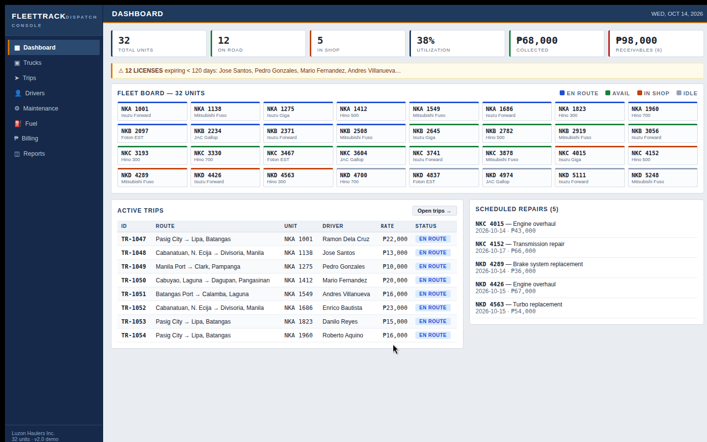
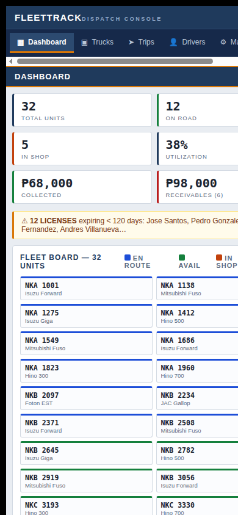

# FleetTrack

[](LICENSE)
[](https://bryan-cantila.github.io/fleettrack/)
[](index.html)

A dispatch console for trucking fleet and trip management. Single-file SaaS demo.



## What it is

FleetTrack is a dispatch-console interface for a fictional trucking company: dense data tables, tabular numerals, and a steel-blue theme laid out for dispatchers who work in the app all day. It models a 32-truck fleet — 12 en route, 10 available, 5 in shop, 5 idle — with the full operating picture on one screen.

## Features

- **Fleet board** — all 32 units on one color-coded board (en route, available, in shop, idle)
- **Active trips** — trip list with driver assignments, routes, and status
- **Dispatch actions** — assign drivers, update trip status, manage the queue
- **Maintenance** — service scheduling and shop status per unit
- **Fuel** — fuel tracking per unit
- **Billing** — invoicing view for completed trips
- **Reports** — operational summaries
- **Persistence** — state saved to `localStorage`, survives reloads
- **Responsive** — dedicated desktop, tablet, and mobile layouts



## Run it

No build step, no dependencies, no backend. Open `index.html` in a browser, or serve it locally:

```
npx serve .
```

Then open the URL it prints. A hosted demo is linked in the badges above.

## Project structure

```
fleettrack/
├── index.html   # the entire app — markup, styles, and logic
├── docs/        # screenshots
├── LICENSE      # MIT
└── README.md
```

Everything is in `index.html` on purpose: the app is a self-contained demo with zero network calls, so there is nothing to install and nothing that can break at runtime.

## Development notes

Designed and built with an AI-assisted workflow: product spec, architecture, and UI decisions directed up front; implementation produced and revised in tight review loops against the dispatch-console brief. Original design and implementation — all UI, data model, and the fictional fleet dataset were created for this project.

## License

**Free to use — just credit devuvo.** Personal, educational, and non-commercial use is free, provided you give visible credit (e.g. "Created by devuvo" with a link to https://www.devuvo.com). Business or income-generating use requires devuvo's prior approval — contact admin@devuvo.com (a license fee may apply). See [LICENSE](LICENSE) for the full terms.
